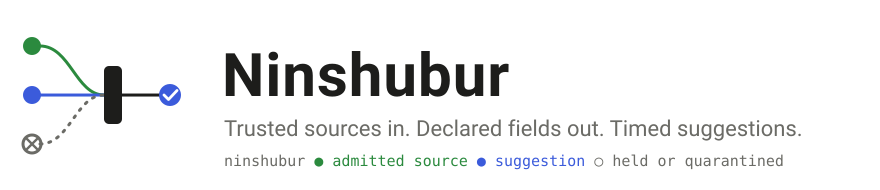

<div align="center">

<picture>
  <source media="(prefers-color-scheme: dark)" srcset="docs/img/banner-dark.svg">
  
</picture>

**A policy-first crawler for public sources.** Ninshubur reads only the sources a person has admitted, keeps only the fields each source declared, and turns what it finds (conferences, public service requests, hiring postings, provider status) into timed, costed suggestions you accept or dismiss. What counts as a good find is set by a profile, a short YAML file of keywords, titles and companies: a job search is one profile, a client's list of target companies another. Nothing is ever executed automatically.

[](https://github.com/alexb-joat/ninshubur/actions/workflows/ci.yml)
[](https://github.com/alexb-joat/ninshubur/actions/workflows/codeql.yml)


[](LICENSE)

[Quick start](#quick-start) &nbsp;·&nbsp; [How a team uses it](#how-a-team-uses-it) &nbsp;·&nbsp; [Layout](#layout) &nbsp;·&nbsp; [What it will not do](#what-it-will-not-do) &nbsp;·&nbsp; [Operator guide](docs/USAGE.md)

<sub><i>Ninshubur (𒀭𒎏𒋚): the Sumerian messenger who carried word between realms and did exactly what was asked, nothing more.<br>Here it carries what reviewed sources say, and acts on nothing by itself.</i></sub>

</div>

<br>

## What it looks like

<!-- gen:readme-sample -->
```console
$ ninshubur status
sources: ok 5
  confs-2026           confs_tech   T1 rep 0.79 ok                   next 2026-11-26 14:06 review 2027-02-09
  event-sites          event_sites  T2 rep 0.53 ok                   next 2026-11-26 17:47 review 2027-01-12
  hn-freelancer        hn           T2 rep 0.52 ok                   next 2026-11-25 18:21 review 2027-01-10
  provider-docs-anthropic provider_docs T0 rep 0.90 ok                   next 2026-11-27 16:21 review 2027-01-12
  provider-docs-openai provider_docs T0 rep 0.90 ok                   next 2026-11-27 15:09 review 2027-01-12
items held 0, tainted 0; quarantine rows (7 d) 0; new candidates 9
suggestions: new 3

$ ninshubur suggest --top 1
#3 [conference_prospecting] Prospect Remote Growth Summit (Online, 2026-12-01): 7 paying companies, 11 speakers  (T2 unverified)
    value 75 USD  cost 23 USD  roi 2.3  confidence 0.50  profile agency-internal
    due 2026-11-26 (best: 2026-11-25 to 2026-11-25, Europe/Lisbon)  expires 2026-12-02
    - Remote Growth Summit starts 2026-12-01 in Online; 7 companies paid for presence, 11 speakers listed
    - profile match: 0 target companies, 1 speakers with target titles; geo/topic factor 0.50
```

<sub>Captured 2026-11-25 from the replay of `tests/samples` (`ninshubur run --replay tests/samples` in a temporary home), not from live data. Rebuild it with `python scripts/readme_sample.py --update`.</sub>
<!-- /gen -->

## Three rules

| Source trust policy | Declared extraction | Fail closed, degrade gracefully |
|---|---|---|
| A source is fetched only after a named reviewer admitted it through the H1–H8 checklist (`ninshubur sources test NAME`). Tiers 0–3 set starting reputation, review cadence and evidence weight. Links found in content become *candidates* for a human, never fetch targets. | Every adapter ships a schema; `project()` keeps only those fields, sanitises them and drops the rest. Raw bodies never touch disk. | Transport, structure and content detectors quarantine bad items (hashes only), downgrade the source (`suspect`, then `quarantined`), hold the affected suggestions and keep serving from the last known-good snapshot. |

These are tested invariants: 272 tests, including a malicious-input corpus, run on Linux, macOS and Windows with Python 3.11, 3.13 and 3.14. Two runtime dependencies (httpx, PyYAML); no LLM calls in this phase.

## Status

Phase 1 (policy core, rules-only analysis): `confs_tech`, `greenhouse`, `ashby`, `lever`, `hn`, `statuspage`
adapters, plus `provider_docs` (LLM providers' model documentation, exported with `ninshubur export euboulia-facts` for the Euboulia extension); builders `cfp_submit`, `conference_trip`, `service_request_lead`,
`hiring_signal_outreach`, `tool_outage`; ICS calendar sink; Markdown/HTML/CSV exports; CLI. One LLM call, run by hand: `ninshubur qualify` asks a model the
profile's own question about each company and keeps only answers that cite evidence lines it was shown (local model by default; see docs/USAGE.md, 6c).

## Quick start

```bash
python -m venv .venv && . .venv/bin/activate
pip install -e .
mkdir -p ~/.ninshubur
cp config.example.yaml ~/.ninshubur/config.yaml
cp profiles.example.yaml ~/.ninshubur/profiles.yaml
ninshubur check                     # policy, config, schemas, review dates
ninshubur sources test confs-2026   # admission checklist H1-H8 against the live source
ninshubur run                       # fetch due sources, rebuild suggestions
ninshubur suggest --plan 45m        # best set for 45 minutes of human time
ninshubur show 3 && ninshubur accept 3
ninshubur status                    # health, held, quarantined, candidates
```

## How a team uses it

The full operator guide is [docs/USAGE.md](docs/USAGE.md). In short:

1. **One profile per client** in `~/.ninshubur/profiles.yaml` (start from `client-template` in
   `profiles.example.yaml`): cities and countries, titles, keywords and pains, target companies,
   providers in use, home base and home country. `ninshubur profiles check` says which suggestion
   kinds each profile can feed and what is missing.
2. **Admit the client's sources.** Target companies with a Greenhouse board:
   `ninshubur sources add acme-jobs --adapter greenhouse --param 'boards=[acme]' --tier 0 ...`
   runs the H1-H8 checklist and refuses anything that fails it. `sources candidates` lists hosts
   seen in content; they are never fetched until a human admits them (`--reject` clears noise).
3. **Run.** `ninshubur run` once, or `deploy/linux/install.sh` for the daemon. Each run fetches
   what is due, applies the policy, rebuilds suggestions and the calendar feed.
4. **Review.** `ninshubur suggest --profile <client>` ranks by return on human time;
   `suggest --held` shows what the policy is holding and why (tainted evidence, suspect source,
   needs corroboration). `show ID` prints steps, reasons with the full value/cost formula, and
   evidence with the exact extracted fields and fetch time. `accept`, `dismiss --reason`, `done
   --outcome` record the decision; accepted items land in `feeds/timings.ics`.
5. **Export for the weekly review.** `ninshubur export digest --profile <client> --format md`
   (or `html`, then Print to PDF in a browser; or `csv`) writes to `feeds/`. `export items --format csv`
   dumps everything gathered. The daemon writes one Markdown digest per profile each ISO week.
6. **Tune.** Costs and base values are in `config.yaml` (`costs`, `base_value_usd`); the formula
   in every suggestion shows which number to change. Accept/dismiss/done feed the calibration
   counters that later phases use.

Suggestion kinds today: `conference_prospecting` (the companies and speakers listed on an upcoming or recently held event's site; see docs/USAGE.md),
`cfp_submit` (call for papers closing in 3-90 days), `hiring_signal_outreach` (a target company or
a matching role is hiring: Greenhouse, Ashby and Lever boards and HN "Who is hiring?" posts), `service_request_lead`
(a public "seeking freelancer" style request matching the profile), `tool_outage` (a major incident
at a provider in `tools_in_use`). Nothing leaves the machine: no push, no telemetry, no model calls
in this phase.

Offline: `ninshubur run --replay tests/samples` runs the real pipeline on the shipped samples.
`python scripts/smoke.py` does that end to end in a temporary home; `pytest -q` runs the suite,
including the malicious-input corpus in `tests/test_malicious.py`.

## Known limits

What it does not do yet, each with the place that shows it (a test, a doc or a line of code):

- **The qualifier is not yet a filter.** With the prompt fixed in advance, no Claude model was shown to agree with one person's labels more often than a rater that always says "no". (docs/case-study.md:3)
- **One labeller, small samples.** The case study rests on one person's labels; nobody else labelled, so there is no human-to-human agreement to compare against. (docs/case-study.md:204)
- **The explorer runs on Linux only.** On macOS and Windows every `ninshubur explore` command refuses with the reason; the rest of Ninshubur runs as before. (tests/test_linux_only.py:1; ninshubur/explorer/__init__.py:19)
- **A host whose robots.txt answers 401 or 403 is off limits** until a person has read its terms and recorded that exact answer as `robots_reviewed_status` for the source, and only on the adapter's fixed hosts. (ninshubur/fetch.py:557; tests/test_fetch.py:215)
- **Only a source with an adapter can be read.** A source names one of the adapters in `ninshubur/adapters/`; a site none of them reads stays closed until someone writes one. (ninshubur/adapters/base.py:147)
- **Pages are read as the server sends them.** No browser or JavaScript engine is part of it (the runtime dependencies are httpx and PyYAML, and tzdata on Windows), so text a page builds in the browser is not seen. (pyproject.toml:12)
- **The content detectors match known patterns.** Hidden characters, prompt-injection phrasing, active HTML and key-like strings are flagged by pattern; a hostile page that uses none of them is not flagged. (ninshubur/detectors.py:86)

## Layout

```
ninshubur/policy.yaml   shipped floor; ~/.ninshubur/policy.yaml may tighten, never loosen
ninshubur/policy.py     allow_fetch, admission_check, allow_store, allow_llm
ninshubur/schemas.py    SCHEMAS registry + project()
ninshubur/detectors.py  transport / structure / content / behaviour detectors
ninshubur/fetch.py      the ONLY network gate (robots, pacing, caps, redirects, conditional GET)
ninshubur/ingest.py     quarantine, reputation, health, snapshots, items
ninshubur/schedule.py   due sources, run_source, growth/backoff
ninshubur/analyze/      relevance, timing, value, suggestion builders
ninshubur/sinks/        ics (trello, google_calendar, platform in later phases)
```

Data lives in `~/.ninshubur` (`NINSHUBUR_HOME`): `ninshubur.db`, `logs/{fetch,policy}.jsonl`,
`feeds/timings.ics`. All files are 0600 on POSIX.

## What it will not do

No login, CAPTCHA or paywall bypass, no proxies or fingerprint evasion, no LinkedIn / Facebook /
X / Reddit HTML, no fetching of URLs found in content, no person data outside the B2B
professional whitelist, no cloud model for anything containing person data. These are tested
invariants, not configuration.

License: [GNU AGPL-3.0-or-later](LICENSE). Copyright (C) 2026 Alex Bubnov.

Ninshubur can run as a service, so the AGPL's network clause applies: a modified version offered to others over a network must ship its modified source under the same licence. The currently-public commits remain under their original MIT terms.

**Name:** "Ninshubur" is the project name, not part of the code licence. A fork must use a different name and must not imply endorsement by or affiliation with this project.
